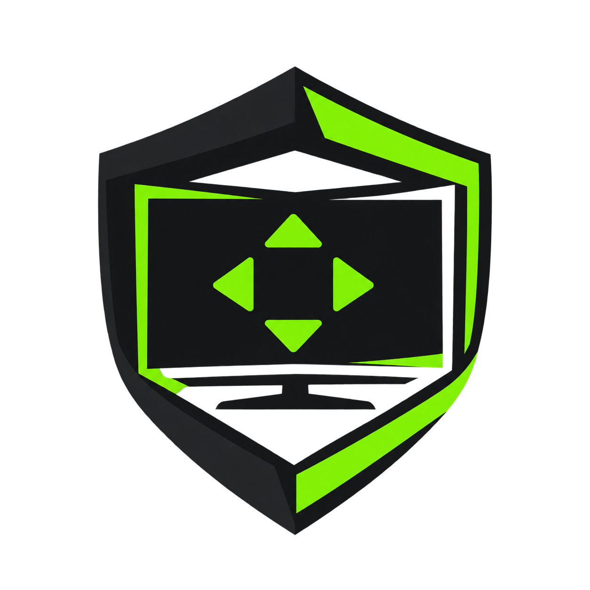
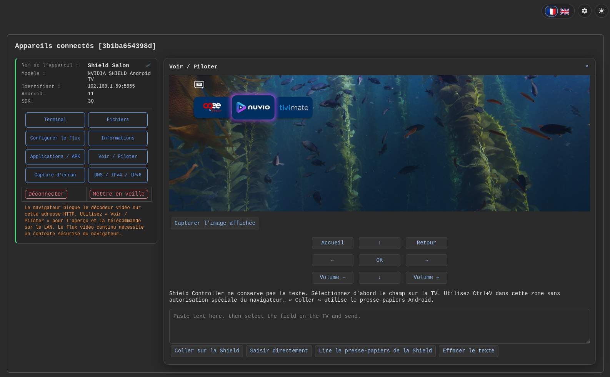
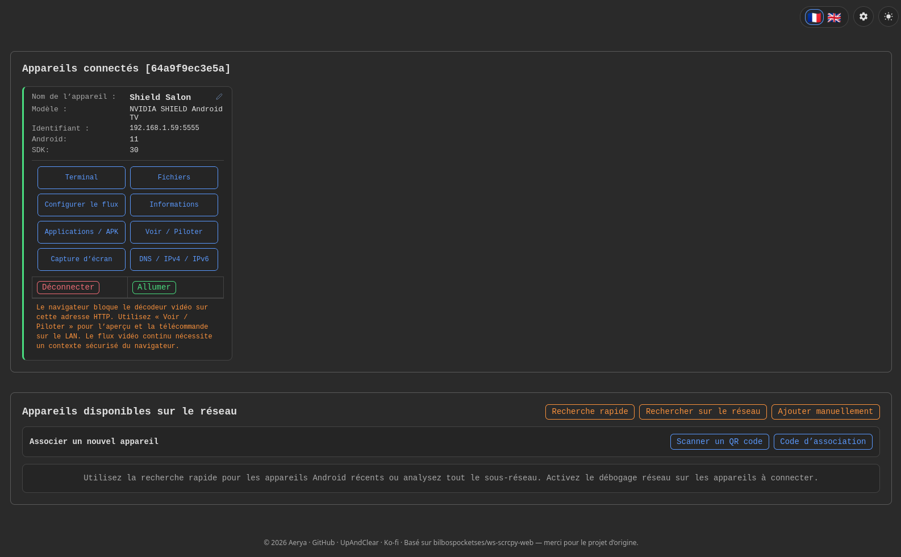
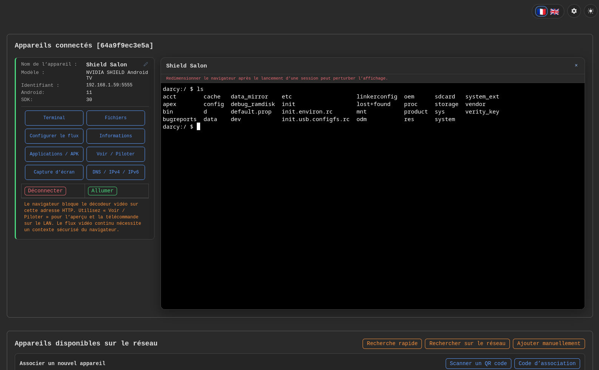
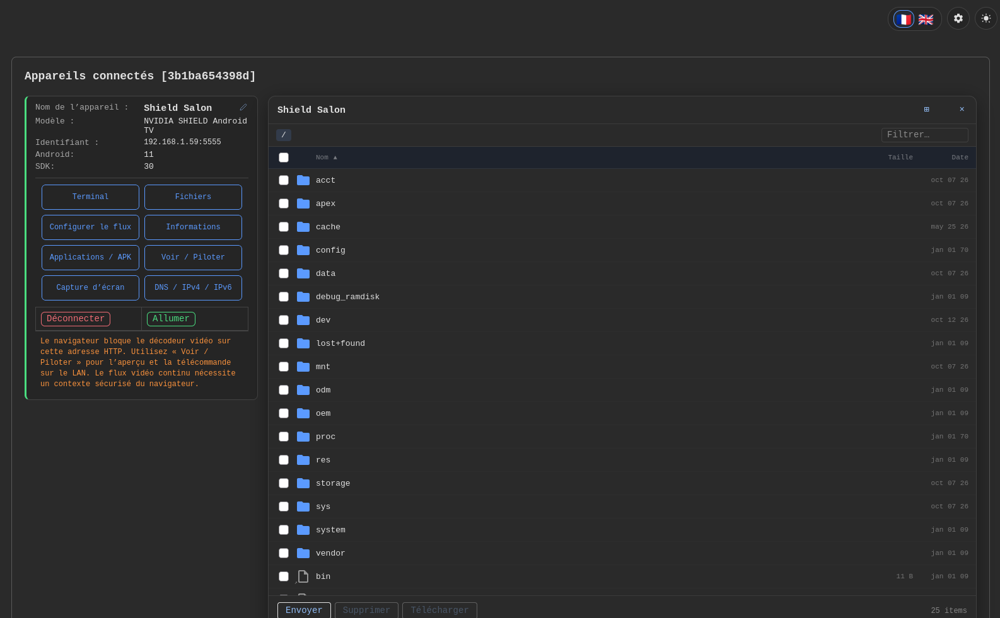
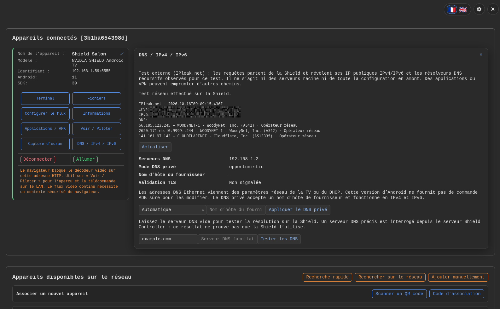
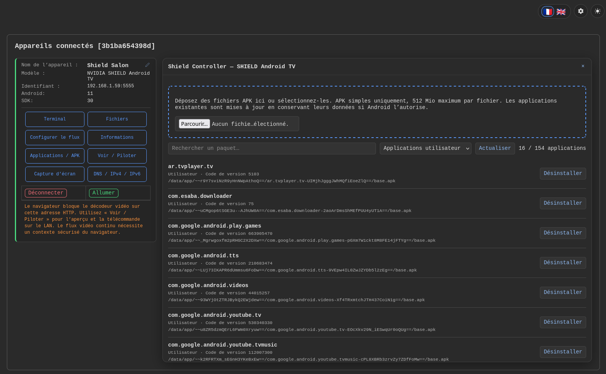
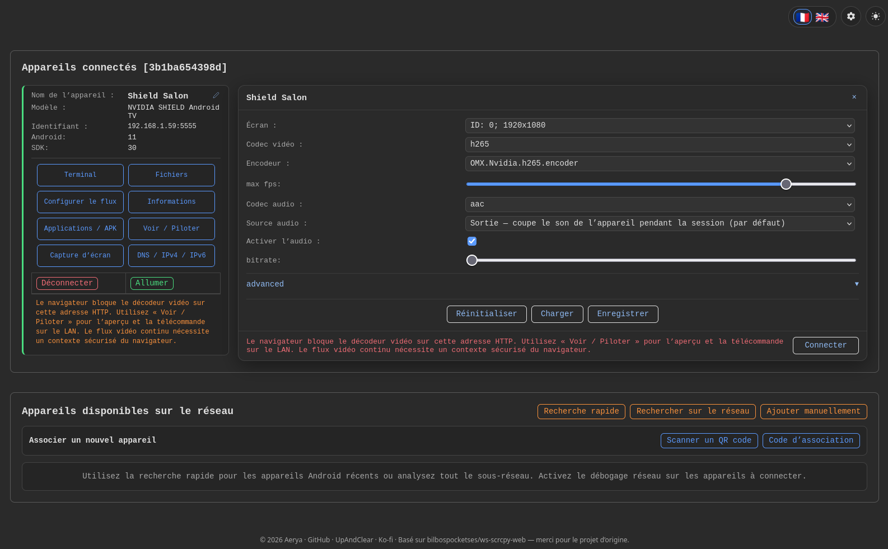
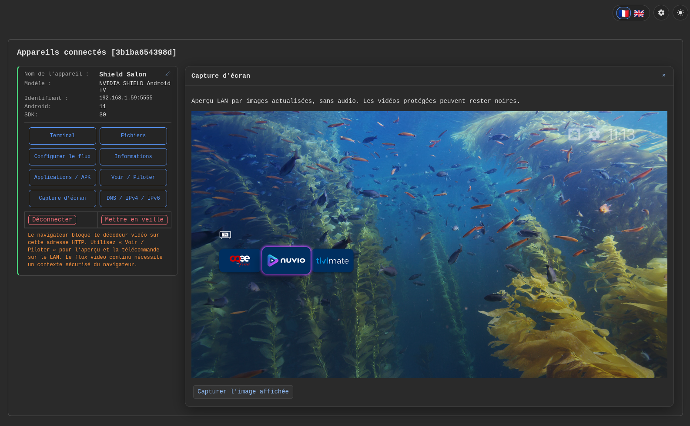

# Shield Controller

<p align="center">
  
</p>

Manage your **NVIDIA Shield / Android TV** from a browser. Self-hosted with Docker.

[🇫🇷 Français](README.md)

### TLS security — October 2026

Update image trust stores and TLS components following the eMudhra incident. Checks cover the compromised chains, including both No CT cases, and a valid HTTPS connection. Running images remain unchanged: schedule their replacement after validation.

[Incident details](https://emudhra.we-have-a-problem.com/) · [TLS checks](security/emudhra/README.md)

## Features

- Screen preview and remote control: D-pad, keyboard and text input
- Detailed information: Android, hardware, RAM, storage, network and display
- Drag-and-drop APK installation with upload progress and Android error messages
- Application list with search, user/system/disabled filters and uninstall confirmation
- Remembered devices reconnect automatically at startup
- File browser, transfers and ADB terminal
- French/English interface with tool panels to the right of the device
- PNG screenshots with preview and download, including over LAN HTTP
- Automatic public IP and IPv4/IPv6 DNS detection with provider names, domain tests and Android Private DNS
- HDMI-CEC, frame rate, long-press, animation, surround sound, display density and default launcher settings, with restore to original
- Confirmed recommended cleanup, bulk re-enable, and snapshots to roll back or copy a setup
- CPU, RAM, storage, available temperatures, Android-declared home and foreground application monitoring (optional refresh every 5 seconds)
- Persistent reference configuration with drift detection and selective restoration after updates
- Live Home button test with optional restoration of the recorded original launcher
- Google TV and vendor compatibility diagnostics, with protection for known essential and persistent components
- Before/after RAM and CPU measurements with uptime and reboot context
- Optional installation and configuration of the TV Detox launcher, with SHA-256 verification

- Privacy audit with Android evidence, ACR/voice/telemetry components and JSON export
- Shield model profiles and additional protections for remote control, audio and firmware updates
- Launcher benchmark: cold start, return Home, janky frames and PSS memory, with persistent comparison
- Optional CleanYourTV launcher, built from a pinned revision and bundled with SHA-256 verification

- Reversible stock launcher replacement with Home verification and persistent recovery
- Remote button mapping through an optional Android companion: short/long/double press, apps and system actions

## Screenshots

| | |
| --- | --- |
| **Remote control and text pasting**<br>[](assets/screenshots/remote-control.png) | **Overview and network discovery**<br>[](assets/screenshots/overview.png) |
| **ADB terminal**<br>[](assets/screenshots/terminal.png) | **File browser**<br>[](assets/screenshots/files.png) |
| **Public IPs and IPv4/IPv6 DNS**<br>[](assets/screenshots/dns.png) | **Applications and APK installation**<br>[](assets/screenshots/applications.png) |
| **Stream settings**<br>[](assets/screenshots/stream-settings.png) | **Screenshot preview**<br>[](assets/screenshots/screenshot.png) |

## Optimization

The panel opens in **Everyday optimization**: telemetry, diagnostics, Plex, user apps, and disabled or protected apps. **Advanced — all applications** exposes the full inventory without removing any option. Dedicated filters also show system components, user apps and protected apps. Apps whose system status is unknown remain visible in the default view.

Known apps have readable names and explanations of their purpose and the consequences of disabling them. This information comes from a curated catalog, not APK label extraction. Unknown packages are explicitly identified as such; their technical identifiers remain visible and searchable. Search matches translated names, package identifiers and explanations within the selected view. Lists use 12 apps per page with a counter, grouped actions, and diagnostics and protection information above the list on desktop and mobile.

The **Optimization** panel lists apps for the active Android user, a process CPU snapshot, memory and storage. A snapshot does not establish that an app slows down boot.

Individual actions are **Disable**, **Enable**, **Protect**, and **Remove manual protection**. Disabling preserves data but stops the app’s functions and services until enabled again. Filters distinguish NVIDIA/Google telemetry and feedback, NVIDIA diagnostics, the local Plex server (`com.plexapp.mediaserver.smb`) and Plex player (`com.plexapp.android`). Plex database maintenance and Scrob are out of scope.

Before each disable (and in the existing uninstall API), the server checks the resolved home launcher, foreground app and published media sessions (including paused sessions). **Protect** your usual player to keep it protected when closed or when it does not publish a media session. Nothing is disabled without your confirmation. If Android cannot provide reliable protection information, disabling requires a fresh valid diagnostic; enabling remains available.

Persistent history retains the last 200 attempts per device and Android user under the server data directory (`optimization/`), including time, action and result. A pending entry may have been interrupted: refresh the actual device state before retrying. Enable apps again using the disabled apps filter. Detection cannot guarantee protection against a simultaneous app switch on the TV.

**Recommended cleanup** offers a short list maintained by Shield Controller. NVIDIA/Google telemetry and feedback are preselected. Optional items (NVIDIA diagnostics, home-screen recommendations, local Plex server, preinstalled apps) are unticked. Apps already disabled or protected are not shown. After confirmation, each app goes through the same protections and checks as an individual disable. Only packages from this list can be disabled in a batch.

**Re-enable apps disabled here** undoes, in one go, the disables made by Shield Controller according to its history. Packages disabled by the firmware itself are left alone; the result lists any re-enable Android refused.

## Settings and tweaks

The **Settings and tweaks** panel changes documented Android settings, each limited to an allowlist of values and verified after writing:

- HDMI-CEC, turning the TV on and off with the Shield
- Match content frame rate (Android 12+; on the Shield, use the NVIDIA setting in the TV menu)
- Remote long-press delay
- Animation scales (window, transition, duration)
- Surround sound output (automatic, never, always, manual)
- Display scaling (density from 160 to 640 dpi, resettable)
- Default launcher among installed home screens

The value seen before the first change is kept on the server (`tweaks/`): **Restore original** puts it back. Settings unavailable on the device’s Android version are greyed out. Private DNS stays in the DNS panel.

### Snapshots

**Save snapshot** downloads a JSON file with each app’s enabled/disabled state, the settings above, density and launcher. **Load snapshot** first shows the differences with the device, then **Apply snapshot** applies them. On the same device this rolls back; on another one it copies the setup.

The launcher changes first, then re-enables, settings, density and finally disables. Protections still apply. Missing apps, unavailable settings and “Android default” values are skipped and listed. Each step’s result is shown; a refused step does not stop the others.

### TV maintenance

In **Settings and tweaks → TV maintenance**:

- **Save reference configuration**, then **Check my configuration** after an update: differences are displayed without changing the TV. Select the desired changes and confirm **Restore selected differences**. Protections still apply and skipped items remain visible. References persist on the server under `maintenance/`, per device (ADB identifier) and Android user, independently of downloadable JSON snapshots. A different ADB address creates a separate reference. Unrestorable “Android default” settings are reported as skipped.
- **Test Home button** explicitly opens Settings and presses Home after confirmation. Select the expected launcher; the report shows the observed application. Restoring the original launcher on failure is optional and requires an original recorded by Shield Controller. Unrecognized vendor routing is reported as unverified; no launcher is disabled and no reboot is performed. This interrupts the current TV screen.
- **Compatibility** identifies Google TV and known TV components (HDMI, remote, setup, Cast, screensaver…). Known essential components and packages marked `PERSISTENT` are protected against disabling and uninstalling. The catalog is not exhaustive; unknown applications are not declared safe to disable. Keep the screensaver enabled on OLED displays.
- **Measure before / Measure after** compares available RAM, a one-second CPU sample and uptime. The before measurement persists. A different or unknown boot is explicitly reported: these figures do not prove a speed improvement. Use comparable workloads.
- **Install TV Detox** optionally installs the TV Detox Android launcher, pinned to **1.5.6**, downloaded from its official release and verified by SHA-256. Installation is limited to Android user 0, keeps the stock launcher enabled and never uninstalls an existing app on a signature conflict. The server needs outbound Internet access to GitHub. Once installed, configure application order (package identifiers), Bluetooth/sound/picture shortcuts and clock format, then open the launcher from this panel. Sending configuration replaces these options; the panel does not read the launcher's internal preferences. Shortcut availability depends on firmware. To select it as Home, refresh **Settings and tweaks**, choose **Default launcher** and test Home. Google TV may keep opening its stock home screen; the separate “Home still opens the stock launcher” workflow offers confirmed, reversible replacement for supported packages.

These features are implemented natively in Shield Controller. No external `install.sh`, `check.sh` or cleanup script is executed. The optional launchers and remote companion are separate Android applications. Installation does not guarantee compatibility with every model. Automated validation uses simulated ADB responses; firmware-specific behavior still needs verification on the device.

### Privacy, model profiles and benchmark

In **Settings and tweaks → TV maintenance**:

- **Audit privacy** inspects up to 25 known or candidate components: voice assistants, automatic content recognition (ACR), and telemetry. Reports distinguish known roles, Android-selected voice services, declared microphone permissions and accesses in the available AppOps history. Name matches remain unverified; shared system UIDs prevent attribution to an individual app. “Unknown” does not mean “no access”. The audit changes nothing, respects the active Android user and supports JSON export.
- **Model profile** recognizes Shield 2017, 2019 tube and Pro 2019 identifiers, plus the 2015/2017 family. Advice depends on firmware. TV recommendations are now protected because NVIDIA's phone remote may depend on them after reboot. Known NVIDIA pairing, audio, settings and update services are protected too. No community bulk-disable list is applied.
- **Benchmark launcher** requires confirmation: opens Settings, returns Home, moves focus with six directional keys, then stops and restarts the launcher for a cold-start measurement. Reports include Android launch/return timings, rendered/janky frame counter differences and PSS memory. This does not measure physical remote latency. Missing or unreliable values remain unavailable. The last result persists per device/user on the server for before/after comparisons, with JSON export. Use similar workloads and comparable conditions. This action interrupts the current screen.
- **Install CleanYourTV**, optional, installs APK **3.1**, built from pinned revision `fcde1eedb4d6cc5ab683a6e0e9e1bc79229b898e` and included in the Docker distribution. SHA-256 is checked before installation. Requires Android **8+** and Android user **0**. **Open CleanYourTV** opens its interface; appearance, dock, app order and modules are configured on the TV. External themes remain managed through the launcher's tools. Select the default launcher in existing settings and test Home afterwards. Installation never disables the stock launcher or uninstalls an app to resolve a signature conflict. This APK is a build made for this project, not an official upstream binary release.

Outside Docker, keep `assets/launchers/` in the working directory. `scripts/build-clean-launcher.sh` rebuilds the APK with Docker (JDK 17, SDK 34), runs its tests and Android Lint, then prints the SHA-256 to update in `CleanLauncher.ts`. The private `shield-clean-gradle` volume preserves the signing key: a different key may prevent updating an existing installation. Rebuilding does not contact a TV. Shield Controller runs no external cleanup or device-installation scripts.

Integration tests use simulated ADB responses; they do not replace validation on your TV's firmware.

### Stock launcher still opens on Home

In **TV maintenance → Home still opens the stock launcher**, select **Diagnose launcher routing**, choose the alternative and the stock launcher to disable, then confirm **Verify alternative and replace Home**. This interrupts the current TV screen.

The server verifies that the alternative is an installed, enabled Home activity, opens it and checks the foreground activity before disabling anything. It records the original state, selects the new Home, disables only the selected stock launcher, then tests a Settings → Home transition. Failure triggers a restoration attempt. Only `com.google.android.tvlauncher` and `com.google.android.apps.tv.launcherx` are supported; packages marked `PERSISTENT` are refused. Other vendor and initial setup components are not disabled by this workflow.

**Restore stock launcher**, available by running diagnostics again, restores its original enabled state and the previous Home. A per-device, per-Android-user journal is saved in `maintenance/` before the first change. If ADB disconnects or restoration fails, the journal remains: reconnect the same device with the same user and retry restoration. A different ADB address does not automatically find the old journal. Keep the `/data` volume. Ordinary launcher selection, optional launcher installation and the existing Home test still do not disable anything.

### Remote button mapping

In **TV maintenance → Remote button mapping**:

1. **Load remote configuration**, then **Install remote companion**. The **Shield Controller Remote 1.1** APK, built from `companion/`, is bundled in Docker and checked against SHA-256 before installation. Android **8+**, Android user **0** for installation. Signature conflicts are reported without uninstalling the existing app.
2. **Open companion setup**, then enable **Shield Controller Remote** in accessibility settings on the TV. Some Android versions may require allowing restricted settings in the app information screen. If the TV reports that no app can open this screen, return to the web panel, **Update remote companion**, then **Enable remote service (ADB)** and confirm. The signed update preserves mappings. Setup skips the Google TV framework stub that displays this message and falls back to general settings with navigation instructions. It also offers guarded links to general settings and app information, with a guide if no screen is available. ADB activation preserves other services and refuses to reactivate globally disabled services.
3. Check **Service registered**, **Enabled in Android** and the actual service connection. Enabled but disconnected does not prove remapping works. Press a supported button and **Refresh remote status** to see its code. The panel reports the actual service connection; firmware may intercept a button before it reaches the service.
4. **Add button mapping**, choose a short action and optionally a long (**600 ms**) or double (**300 ms**) press, then **Save button mappings**. Actions: open an app discovered on the TV, Home, Back, recent apps, notifications or do nothing. Every mapped button needs a short action; double press delays it by 300 ms.
5. **Remove mapping** and save, or **Reset all button mappings**, to return buttons to the system. The companion also offers a local reset on the TV, even if the server is unavailable. **Disable remote service (ADB)** suspends remapping without deleting mappings or disabling other services.

Supported codes cover Home, Back, Menu, Search, media keys, Guide, coloured keys and generic buttons 1–3. There is no universal Netflix key code: use the code actually observed only if it is in the list. Power, sleep, volume, microphone, directional navigation and confirmation are not remapped. Unconfigured keys pass through. Home, special buttons and some actions may remain reserved by firmware; universal remapping is not guaranteed. Another key-filtering accessibility service may prevent this one from receiving events. Mappings execute on the TV and work without the browser or server connection.

On NVIDIA Shield, **Open remote and accessory settings** uses the public Android Bluetooth settings intent. Depending on firmware, navigate to **Remotes & accessories → Customize Menu button** for native settings; private NVIDIA settings are not written automatically.

The companion requests no network or screen-content access. Mappings are stored in private preferences; only the last supported button code is retained in memory, with no typed text or key history. Its ADB interface accepts only the system shell or root UID, not ordinary applications. Both sides validate actions and key codes. The APK is covered by the project's GPL-3.0-only license.

Companion 1.1 validation: signed update preserving mappings, service registration, activation and deactivation verified on an Android TV 11 emulator. Physical key delivery and NVIDIA firmware still need verification on the affected TV.

To rebuild, `scripts/build-remote-companion.sh` requires JDK 17, Android SDK Platform 34 and Build Tools 34.0.0, `ANDROID_HOME`, and `REMOTE_SIGNING_DIR` pointing to a persistent private directory **outside the repository**. It runs JVM gesture tests, compiles and signs the APK, then prints the SHA-256 to update in `RemoteMapping.ts`. Retain the signing key for updates; never publish the key or password. `REMOTE_APK_OUTPUT` selects a separate verification output. CI compiles the companion with a temporary key and compares its DEX code and resources to the bundled APK.

ADB and browser tests use simulated devices; gestures are tested on the JVM. No physical remote or TV validation is claimed. Verify Home routing, key delivery and restoration on your firmware.

## Docker

For **Linux amd64**, use this Compose file in Dockge or with `docker compose up -d`:

```yaml
services:
  shield-controller:
    image: ghcr.io/aerya/shield-controller:latest
    restart: unless-stopped
    ports:
      - "8123:8000"
    environment:
      WS_SCRCPY_ALLOW_REMOTE_ADMIN: "1"
    volumes:
      - ./data:/data
```

Open **http://SERVER_IP:8123** on your LAN. **View / Control** works over HTTP: refreshed screen preview, remote control, pasting and text input. The inherited continuous video stream requires a secure browser context. The variable above grants administrative access to anyone able to reach the service; sign-in is available in Settings → Users.

Build locally: `docker build -t shield-controller:local .`

## Connect your Shield

1. Enable developer options: **Settings → Device Preferences → About → press Build 7 times**.
2. Enable **Network debugging** and note the Shield's IP address.
3. Add `SHIELD_IP:5555` in the WebUI and accept the authorization prompt on the TV.
4. Use **device info** or **applications / APK** on the device card.

Ethernet and Wi-Fi both work. No router port forwarding is needed.

## Remote control and text

Open **View / Control**, select the TV input field with the remote, paste your URL/username in the text box, then click **Paste on Shield**. If the app blocks pasting, try **Type text directly** (300 bytes maximum; non-Latin characters are limited). Shield Controller does not store the text; pasting uses Android’s clipboard. The HTTP preview updates about every 1.5 seconds plus capture time, without audio.

## Notes

Single `.apk` files only, up to **512 MiB each**; split bundles (`.apks`, `.xapk`) are unsupported. Installs update existing apps when Android permits it. Uninstall targets **Android user 0**; removing system apps can break TV functions. App names are shown as package identifiers. Some device details may be unavailable without root. Protected video may appear black in screen mirroring.

## DNS

Each resolver IP includes its known DNS service or network operator (RIPEstat); unavailable identification never hides the result.

Without a custom server, the test runs on the Shield. With an IPv4/IPv6 DNS address, it runs from the Shield Controller server. Private DNS uses a **provider hostname** (DNS-over-TLS). On an unrooted Android 11 Shield, change Ethernet DNS in the TV network settings or DHCP.

Opening the DNS panel automatically detects public IPs and DNS resolvers through [IPleak.net](https://ipleak.net/) from the Shield. It reports observed recursive resolvers, without reading AdGuard Home or listing root servers. Per-app VPN routing may differ.

## Credits & license

- **[Ansub/tv-detox](https://github.com/Ansub/tv-detox)** — inspiration for TV maintenance and provider of the optional Android launcher, under the [MIT license](https://github.com/Ansub/tv-detox/blob/main/LICENSE). Maintenance workflows and compatibility checks are implemented natively; no upstream shell scripts or Java source are incorporated. The APK is downloaded on request, not bundled.
- **[bilbospocketses/ws-scrcpy-web](https://github.com/bilbospocketses/ws-scrcpy-web)** — base project, with device management additions by Aerya.
- **[bryanroscoe/shield_optimizer](https://github.com/bryanroscoe/shield_optimizer)** (ATV Optimizer) — inspiration for settings, recommended cleanup, bulk re-enable and snapshots. Its author forbids using its code: no code or lists are taken from it; the features were rewritten from public Android commands.
- **[Gathin23/cleanyourtv](https://github.com/Gathin23/cleanyourtv)** — inspiration for the natively reimplemented audit, profiles and benchmark; source of the optional compiled launcher. [MIT license and copyright](assets/launchers/LICENSE-MIT.txt); Outfit font under the [SIL Open Font License](assets/launchers/LICENSE-OFL.txt). Notices accompany the APK.
- **[Genymobile/scrcpy](https://github.com/Genymobile/scrcpy)** — screen mirroring.

**GPL-3.0-only** — see [LICENSE](LICENSE). Upstream copyright notices are preserved.
