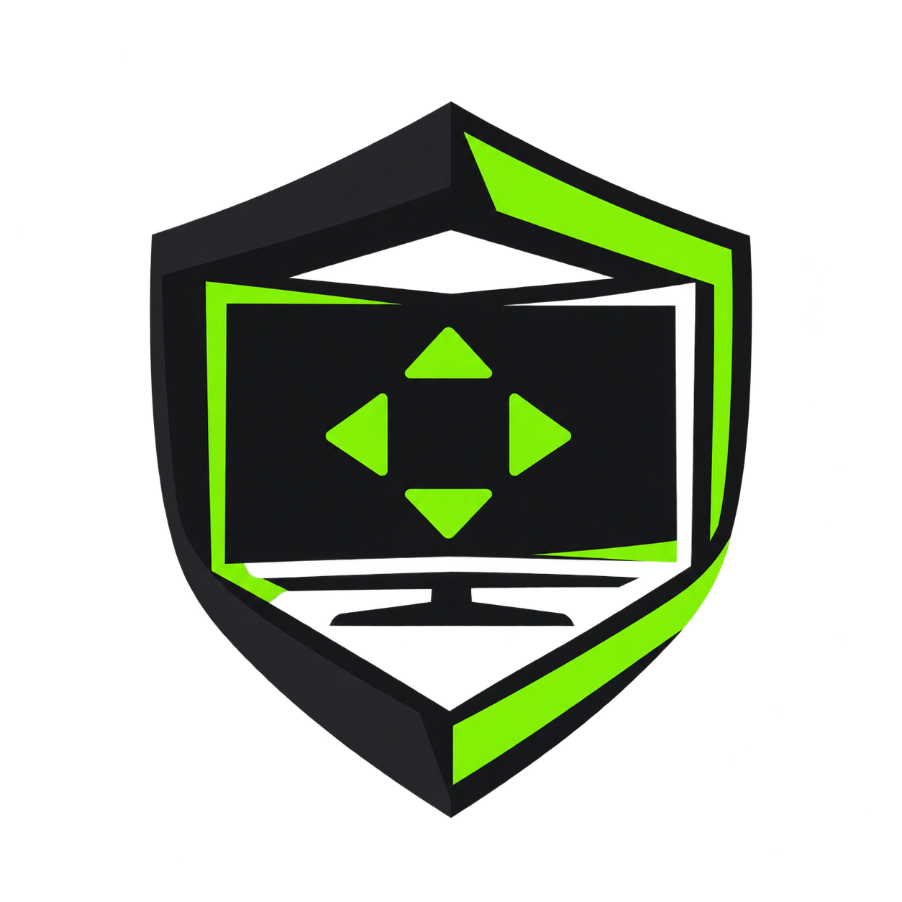
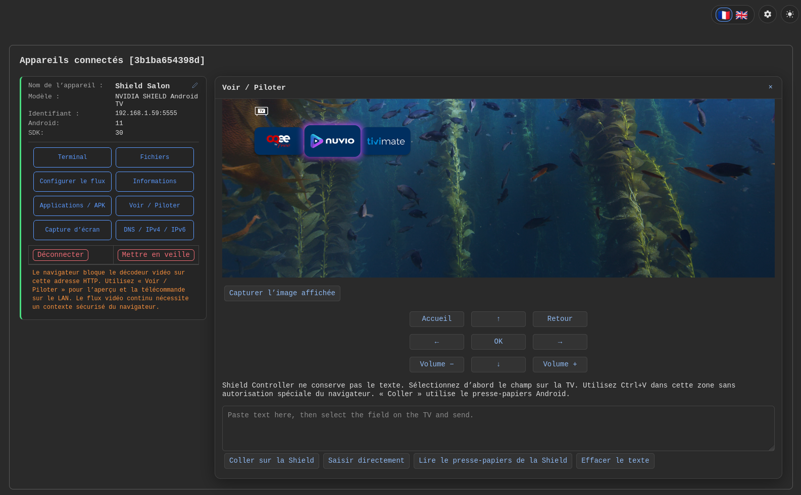
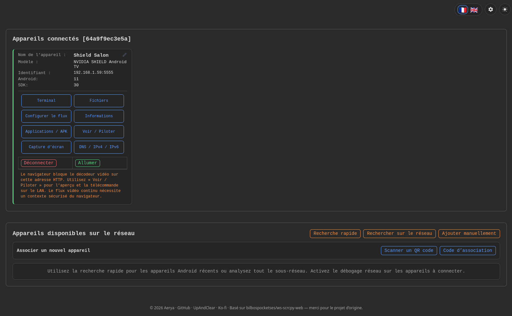
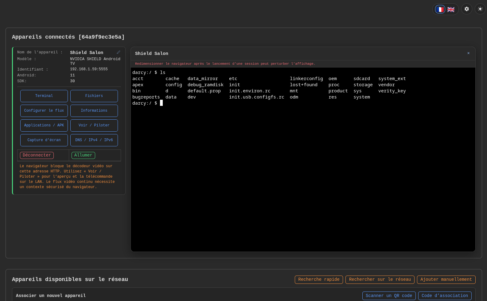
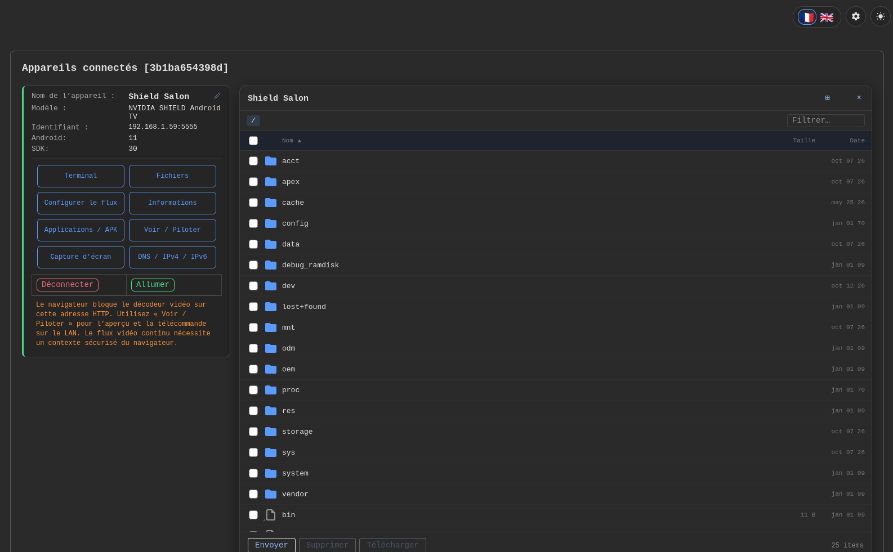
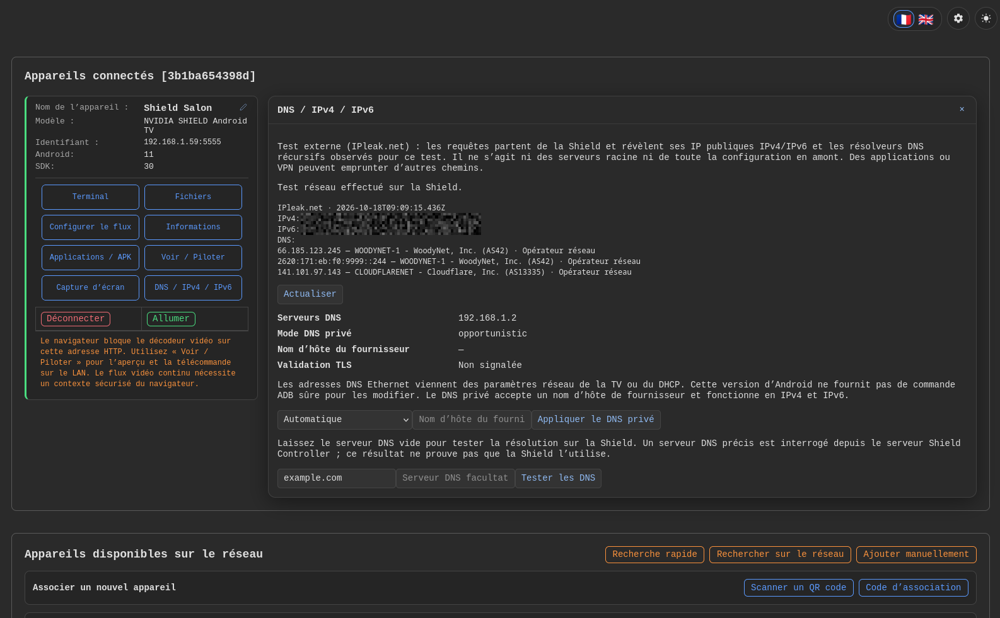
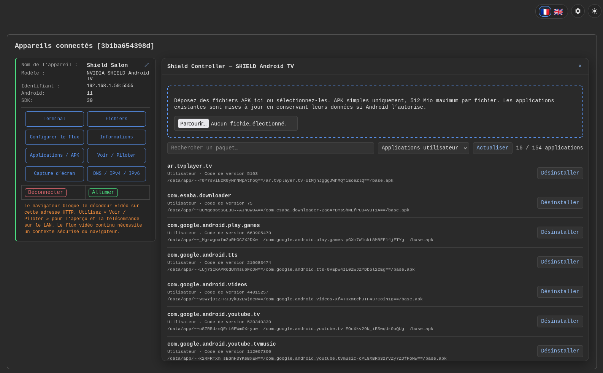
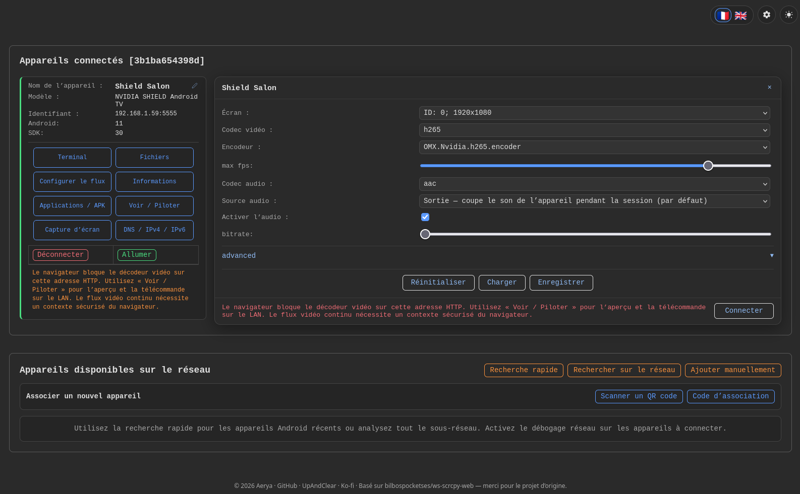
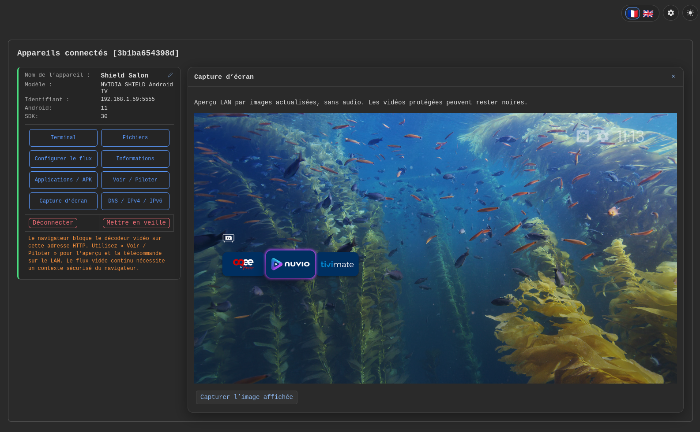

# Shield Controller

<p align="center">
  
</p>

Gérez votre **NVIDIA Shield / Android TV** depuis un navigateur. Auto-hébergé avec Docker.

[🇬🇧 English](README.en.md)

### Sécurité TLS — octobre 2026

Mise à jour des certificats et des composants TLS des images après l’incident eMudhra. Les contrôles couvrent les chaînes compromises, dont les deux cas « No CT », et une connexion HTTPS valide. Une image déjà en cours d’exécution reste inchangée : son remplacement doit être planifié après validation.

[Détails de l’incident](https://emudhra.we-have-a-problem.com/) · [TLS checks](security/emudhra/README.md)

## Fonctions

- Aperçu de l’écran et télécommande : pavé directionnel, clavier et saisie de texte
- Informations détaillées : Android, matériel, RAM, stockage, réseau et affichage
- Installation d’APK par glisser-déposer, progression du transfert et erreurs Android
- Liste des applications avec recherche, filtres utilisateur/système/désactivées et confirmation de désinstallation
- Reconnexion automatique des appareils mémorisés au démarrage
- Explorateur de fichiers, transferts et terminal ADB
- Interface FR/EN, panneaux d’outils à droite de l’appareil
- Captures d’écran PNG avec aperçu et téléchargement, y compris en HTTP sur le LAN
- Détection automatique des IP publiques et DNS IPv4/IPv6 avec nom du fournisseur, test d’un domaine et DNS privé Android
- Réglages HDMI-CEC, fréquence d’images, appui long, animations, son surround, densité d’affichage et launcher par défaut, avec restauration de l’origine
- Nettoyage recommandé à valider, réactivation groupée et instantanés pour revenir en arrière ou copier une configuration
- Suivi CPU, RAM, stockage, températures disponibles, accueil déclaré par Android et application au premier plan (actualisation facultative toutes les 5 secondes)
- Configuration de référence persistante, détection des écarts après mise à jour et restauration sélective
- Test réel du bouton Home avec restauration facultative du launcher d’origine enregistré
- Diagnostic de compatibilité Google TV et constructeur, avec protection des composants essentiels connus et persistants
- Mesures RAM et CPU avant/après, avec durée depuis le démarrage et signalement des redémarrages
- Installation et configuration facultatives du launcher TV Detox, avec vérification SHA-256

- Audit de confidentialité avec preuves Android, composants ACR/voix/télémétrie et export JSON
- Profils des modèles Shield et protections supplémentaires pour la télécommande, l’audio et les mises à jour
- Benchmark du launcher : démarrage à froid, retour à Home, images saccadées et mémoire PSS, avec comparaison persistante
- Launcher CleanYourTV facultatif, compilé depuis une révision fixe et inclus, avec contrôle SHA-256

- Remplacement réversible du launcher d’origine avec vérification Home et restauration persistante
- Remappage des boutons via un compagnon Android facultatif : appuis simple/long/double, applications et actions système

## Captures d’écran

| | |
| --- | --- |
| **Télécommande et collage de texte**<br>[](assets/screenshots/remote-control.png) | **Accueil et découverte réseau**<br>[](assets/screenshots/overview.png) |
| **Terminal ADB**<br>[](assets/screenshots/terminal.png) | **Explorateur de fichiers**<br>[](assets/screenshots/files.png) |
| **IP publiques et DNS IPv4/IPv6**<br>[](assets/screenshots/dns.png) | **Applications et installation d’APK**<br>[](assets/screenshots/applications.png) |
| **Configuration du flux**<br>[](assets/screenshots/stream-settings.png) | **Capture d’écran avec aperçu**<br>[](assets/screenshots/screenshot.png) |

## Optimisation

Le panneau s’ouvre sur **Optimisation courante** : télémétrie, diagnostic, Plex, applications utilisateur et applications désactivées ou protégées. **Avancé — toutes les applications** donne accès à l’inventaire complet, sans retirer aucune option. Des filtres dédiés affichent aussi les composants système, les applications utilisateur et les protections. Si le statut système est inconnu, l’application reste visible dans la vue courante.

Les applications connues présentent un nom lisible et une explication de leur rôle et des conséquences d’une désactivation. Ces informations viennent d’un catalogue, pas de l’extraction des libellés des APK. Les paquets inconnus sont explicitement signalés ; leur identifiant technique reste affiché et recherchable. La recherche porte sur le nom traduit, l’identifiant et l’explication, dans la vue sélectionnée. La liste est paginée par 12 applications, avec compteur ; les boutons restent regroupés et le diagnostic ainsi que les protections apparaissent avant la liste, sur ordinateur comme sur mobile.

Le panneau **Optimisation** affiche les applications de l’utilisateur Android actif, un relevé CPU des processus, la mémoire et le stockage. Un relevé ponctuel ne prouve pas qu’une application ralentit le démarrage.

Les actions individuelles sont : **Désactiver**, **Réactiver**, **Protéger** et **Retirer la protection manuelle**. La désactivation conserve les données ; les fonctions et services de l’application cessent jusqu’à sa réactivation. Les filtres distinguent télémétrie/rapports NVIDIA et Google, diagnostic NVIDIA, serveur Plex local (`com.plexapp.mediaserver.smb`) et lecteur Plex (`com.plexapp.android`). Aucune optimisation de base Plex ou Scrob.

Le launcher résolu par Android, l’application au premier plan et les paquets ayant une session multimédia publiée (y compris en pause) sont protégés côté serveur avant chaque désactivation, ainsi que dans l’API de désinstallation existante. Utilisez **Protéger** sur votre lecteur habituel pour conserver sa protection lorsqu’il est fermé ou ne publie pas de session. Rien n’est désactivé sans votre validation. Si Android ne permet pas de vérifier les protections, la désactivation attend un diagnostic valide ; la réactivation reste disponible.

L’historique persistant conserve les 200 dernières tentatives par appareil et utilisateur dans le répertoire de données du serveur (`optimization/`), avec date, action et résultat. Une tentative « En attente » peut avoir été interrompue : actualisez l’état réel avant de réessayer. La réactivation est accessible dans le filtre des applications désactivées. La détection n’est pas une garantie contre un changement d’application simultané sur la TV.

**Nettoyage recommandé** propose une courte liste propre à Shield Controller. La télémétrie et les rapports NVIDIA/Google sont présélectionnés. Les éléments facultatifs (diagnostic NVIDIA, recommandations de l’accueil, serveur Plex local, applications préinstallées) sont décochés. Les applications déjà désactivées ou protégées n’apparaissent pas. Après confirmation, chaque application passe par les mêmes protections et vérifications qu’une désactivation individuelle. Seuls les paquets de cette liste peuvent être désactivés en lot.

**Réactiver les applications désactivées ici** annule en une fois les désactivations faites par Shield Controller, d’après l’historique. Les applications désactivées d’origine par le firmware ne sont pas touchées ; le résultat indique les réactivations refusées par Android.

## Réglages

Le panneau **Réglages** modifie des paramètres Android documentés, chacun limité à une liste de valeurs autorisées et vérifié après écriture :

- HDMI-CEC, allumage et mise en veille de la TV avec la Shield
- Adaptation de la fréquence d’images au contenu (Android 12 et plus ; sur la Shield, réglage NVIDIA dans le menu de la TV)
- Délai d’appui long de la télécommande
- Échelles d’animation (fenêtres, transitions, durée)
- Sortie son surround (automatique, jamais, toujours, manuel)
- Mise à l’échelle de l’affichage (densité de 160 à 640 dpi, réinitialisable)
- Launcher par défaut parmi les écrans d’accueil installés

La valeur relevée avant la première modification est conservée sur le serveur (`tweaks/`) : **Restaurer l’origine** la remet en place. Les réglages indisponibles sur la version d’Android de l’appareil sont grisés. Le DNS privé reste dans le panneau DNS.

### Instantanés

**Enregistrer un instantané** télécharge un fichier JSON contenant l’état activé/désactivé de chaque application, les réglages ci-dessus, la densité et le launcher. **Charger un instantané** affiche d’abord les différences avec l’appareil, puis **Appliquer l’instantané** les applique. Sur le même appareil, cela permet de revenir en arrière ; sur un autre, de copier la configuration.

Le launcher est changé en premier, puis viennent les réactivations, les réglages, la densité et enfin les désactivations. Les protections restent actives. Les applications absentes, les réglages indisponibles et les valeurs « Android par défaut » sont ignorés et listés. Le résultat de chaque étape est affiché ; une étape refusée n’arrête pas les suivantes.

### Maintenance TV

Dans **Réglages et ajustements → Maintenance TV** :

- **Enregistrer la configuration de référence**, puis **Vérifier ma configuration** après une mise à jour : les écarts sont affichés sans modifier la TV. Cochez les changements voulus puis confirmez **Restaurer les écarts sélectionnés**. Les protections restent actives et les éléments non applicables sont signalés. La référence est conservée sur le serveur dans `maintenance/`, par appareil (identifiant ADB) et utilisateur Android ; elle reste distincte des snapshots JSON exportables. Une adresse ADB différente crée une autre référence. Les valeurs « défaut Android » non restaurables restent signalées comme ignorées.
- **Tester le bouton Home** ouvre réellement les paramètres puis appuie sur Home, après confirmation. Choisissez le lanceur attendu ; le résultat indique l’application observée. Le retour au lanceur d’origine est facultatif et disponible si Shield Controller l’avait enregistré. Un routage constructeur non reconnu est signalé comme non vérifié ; aucun lanceur n’est désactivé et aucun redémarrage n’est lancé. Le test interrompt l’écran en cours.
- **Compatibilité** distingue Google TV et les composants TV connus (HDMI, télécommande, configuration initiale, Cast, économiseur d’écran…). Les composants essentiels connus et les paquets marqués `PERSISTENT` sont protégés contre la désactivation et la désinstallation. Le catalogue n’est pas exhaustif ; une application inconnue n’est pas déclarée sûre à désactiver. Conservez l’économiseur d’écran sur une dalle OLED.
- **Mesurer avant / Mesurer après** compare RAM disponible, CPU échantillonné pendant une seconde et durée depuis le démarrage. La mesure initiale est persistante. Un démarrage différent ou inconnu est explicitement signalé : les chiffres ne prouvent pas un gain de vitesse. Utilisez des conditions de charge similaires.
- **Installer TV Detox** propose facultativement le launcher Android TV Detox, version **1.5.6**, téléchargé depuis sa release officielle et vérifié par SHA-256. L’installation est réservée à l’utilisateur Android 0 ; elle conserve le launcher constructeur et ne désinstalle rien en cas de conflit de signature. Elle nécessite un accès Internet sortant du serveur vers GitHub. Une fois installé, configurez l’ordre des applications (identifiants de paquets), les raccourcis Bluetooth/son/image et l’horloge, puis ouvrez le launcher depuis ce panneau. La configuration envoyée remplace ces options ; ce panneau ne relit pas les préférences internes du launcher. Les raccourcis disponibles dépendent du firmware. Pour le choisir comme accueil, actualisez **Réglages et ajustements**, puis utilisez **Lanceur par défaut** et testez Home. Sur Google TV, le launcher constructeur peut continuer à ouvrir l’accueil ; le parcours distinct « Home ouvre encore le launcher d’origine » permet un remplacement confirmé et réversible sur les paquets pris en charge.

Ces fonctions sont intégrées nativement à Shield Controller. Aucun script `install.sh`, `check.sh` ou de nettoyage externe n’est exécuté. Les launchers facultatifs et le compagnon de télécommande sont des applications Android distinctes. L’installation ne garantit pas sa compatibilité avec tous les modèles. La validation automatisée utilise des réponses ADB simulées ; les comportements propres au firmware doivent être vérifiés sur l’appareil.

### Confidentialité, profils et benchmark

Dans **Réglages et ajustements → Maintenance TV** :

- **Auditer la confidentialité** examine au maximum 25 composants connus ou candidats : assistants vocaux, reconnaissance du contenu affiché (ACR), télémétrie. Le rapport distingue le rôle connu, le service vocal choisi par Android, la permission microphone déclarée et les accès présents dans l’historique AppOps disponible. Une correspondance de nom reste non vérifiée ; un identifiant système partagé empêche l’attribution à une application. « Inconnu » ne signifie pas « aucun accès ». L’audit ne désactive rien ; il respecte l’utilisateur Android actif et propose un export JSON.
- **Profil du modèle** reconnaît les identifiants Shield 2017, 2019 tube et Pro 2019, ainsi que la famille 2015/2017. Les conseils restent indicatifs selon le firmware. Les recommandations TV sont désormais protégées : elles peuvent être nécessaires à la télécommande NVIDIA sur téléphone après redémarrage. Les services NVIDIA connus d’appairage, audio, paramètres et mise à jour sont également protégés. Aucune liste communautaire de désactivation n’est appliquée.
- **Mesurer le launcher** demande confirmation : ouvre les paramètres, revient à Home, déplace la sélection avec six touches directionnelles, puis arrête et relance le launcher pour mesurer son démarrage à froid. Le rapport affiche les durées Android de lancement/retour, les différences de compteurs d’images rendues/saccadées et la mémoire PSS. Ce n’est pas une mesure de latence physique de la télécommande. Les mesures absentes ou non fiables restent indisponibles. Le dernier résultat persiste sur le serveur par appareil/utilisateur pour une comparaison avant/après ; le rapport est exportable. Utilisez la même charge et comparez des conditions similaires. Cette action interrompt l’écran en cours.
- **Installer CleanYourTV**, facultatif, installe l’APK **3.1**, compilé depuis la révision fixe `fcde1eedb4d6cc5ab683a6e0e9e1bc79229b898e` et inclus dans la distribution Docker. Le SHA-256 est vérifié avant installation. Android **8+** et utilisateur Android **0** requis. **Ouvrir CleanYourTV** lance son interface ; l’apparence, le dock, l’ordre des applications et les modules se règlent sur la TV. Les thèmes externes restent gérés par les outils du launcher. Choisissez ensuite le launcher par défaut dans les réglages existants et testez Home. L’installation ne désactive pas le launcher constructeur et ne résout jamais un conflit de signature par une désinstallation. L’APK est une compilation de ce projet, pas une release binaire officielle de son auteur.

Pour une exécution hors Docker, conservez `assets/launchers/` dans le répertoire de lancement. `scripts/build-clean-launcher.sh` reconstruit l’APK avec Docker (JDK 17, SDK 34), exécute ses tests et Android Lint, puis affiche le SHA-256 à mettre à jour dans `CleanLauncher.ts`. Le volume privé `shield-clean-gradle` conserve la clé de signature : une autre clé peut empêcher la mise à jour d’une installation existante. La reconstruction ne contacte aucune TV. Aucun script externe de nettoyage ou d’installation sur appareil n’est exécuté par Shield Controller.

Les tests automatisés de l’intégration simulent ADB ; ils ne remplacent pas une validation sur le firmware de votre TV.

### Launcher qui reprend la main sur Home

Dans **Maintenance TV → Home ouvre encore le launcher d’origine**, lancez **Diagnostiquer le routage de Home**, choisissez l’alternative et le launcher d’origine à désactiver, puis confirmez **Vérifier l’alternative et remplacer Home**. Cette opération interrompt l’écran en cours.

Le serveur vérifie que l’alternative est un accueil installé et activé, l’ouvre et vérifie son activité au premier plan avant toute désactivation. Il enregistre l’état initial, choisit le nouvel accueil, désactive uniquement le launcher d’origine sélectionné, puis teste une transition Paramètres → Home. Un échec déclenche une tentative de restauration. Seuls `com.google.android.tvlauncher` et `com.google.android.apps.tv.launcherx` sont pris en charge ; un paquet marqué `PERSISTENT` est refusé. Les autres composants constructeur et de configuration initiale ne sont pas désactivés par ce parcours.

**Restaurer le launcher d’origine**, accessible en relançant le diagnostic, rétablit son état activé initial et l’accueil précédent. Le journal persiste dans `maintenance/`, par appareil et utilisateur Android, avant la première modification. En cas de coupure ADB ou de restauration refusée, il reste disponible : reconnectez le même appareil avec le même utilisateur et relancez la restauration. Une adresse ADB différente ne retrouve pas automatiquement l’ancien journal. Conservez le volume `/data`. Le choix ordinaire du launcher, l’installation des launchers facultatifs et le test Home existant ne désactivent toujours rien.

### Raccourcis de la télécommande

Dans **Maintenance TV → Raccourcis de la télécommande** :

1. **Charger les raccourcis**, puis **Installer le compagnon**. L’APK **Shield Controller Remote 1.1**, compilé depuis les sources `companion/`, est inclus dans Docker et contrôlé par SHA-256 avant installation. Android **8+**, utilisateur **0** pour l’installation. Un conflit de signature est signalé, jamais résolu en désinstallant l’application.
2. **Ouvrir la configuration du compagnon**, puis activer **Shield Controller Remote** dans les paramètres d’accessibilité sur la TV. Selon Android, il peut être nécessaire d’autoriser les paramètres restreints dans la fiche de l’application. Si la TV indique qu’aucune application ne peut ouvrir cet écran, revenez au panneau web, **Mettre à jour le compagnon**, puis **Activer le service de télécommande (ADB)** et confirmez. Les raccourcis sont conservés lors de la mise à jour signée. Le compagnon évite l’application de substitution Google TV qui affiche ce message et ouvre les paramètres généraux en secours, avec le chemin à suivre. Il propose aussi des accès protégés aux paramètres généraux et à sa fiche application, avec un guide si aucun écran n’est disponible. L’activation ADB conserve les autres services ; elle est refusée si elle risque de réactiver des services globalement désactivés.
3. Vérifier **Service reconnu par Android**, **Activé dans Android** et la connexion effective du service. Un service activé mais non connecté ne prouve pas que le remappage fonctionne. Appuyer sur un bouton pris en charge et **Actualiser l’état de la télécommande** pour consulter son code. Le menu affiche la connexion réelle du service ; un bouton intercepté par le firmware peut ne jamais apparaître.
4. **Ajouter un bouton**, choisir l’appui simple et éventuellement l’appui long (**600 ms**) ou double (**300 ms**), puis **Enregistrer les raccourcis**. Actions : ouvrir une application détectée sur la TV, Home, Retour, applications récentes, notifications ou ne rien faire. L’appui simple est obligatoire pour chaque bouton configuré ; avec un double appui, son exécution attend 300 ms.
5. **Retirer ce raccourci** puis enregistrer, ou **Réinitialiser tous les raccourcis**, rend les boutons au système. La même réinitialisation est disponible directement dans l’application compagnon sur la TV, même si le serveur est inaccessible. Le bouton **Désactiver le service de télécommande (ADB)** suspend le remappage sans supprimer les raccourcis ni désactiver les autres services.

La liste couvre Home, Retour, Menu, Recherche, touches multimédias, Guide, couleurs et boutons génériques 1–3. Il n’existe pas de code Netflix universel : utilisez uniquement le code réellement observé s’il figure dans la liste. Alimentation, veille, volume, microphone, pavé directionnel et validation ne sont pas remappés. Les touches non configurées sont laissées au système. Home, les boutons spéciaux et certaines actions peuvent rester réservés au firmware ; aucun remappage universel n’est garanti. Un autre service filtrant les touches peut empêcher celui-ci de les recevoir. Les raccourcis s’exécutent sur la TV et restent utilisables sans navigateur ni connexion au serveur.

Sur NVIDIA Shield, **Ouvrir les paramètres des accessoires** utilise l’intention Android publique des paramètres Bluetooth. Selon le firmware, remontez dans **Télécommandes et accessoires → Personnaliser le bouton Menu** pour les réglages natifs ; aucun paramètre NVIDIA privé n’est écrit automatiquement.

Le compagnon ne demande ni accès réseau, ni lecture du contenu de l’écran. Il conserve les raccourcis dans ses préférences privées et seulement le dernier code de bouton pris en charge en mémoire, sans texte saisi ni historique des touches. Son interface ADB n’accepte que l’utilisateur système shell ou root ; elle n’est pas accessible aux applications ordinaires. Les actions et les codes sont validés des deux côtés. L’APK relève de la licence GPL-3.0-only du projet.

Validation du compagnon 1.1 : mise à jour signée avec conservation des raccourcis, reconnaissance du service, activation et désactivation vérifiées sur un émulateur Android TV 11. La réception des touches physiques et le firmware NVIDIA restent à vérifier sur la TV concernée.

Reconstruction : `scripts/build-remote-companion.sh` nécessite JDK 17, Android SDK Platform 34 et Build Tools 34.0.0, `ANDROID_HOME` et `REMOTE_SIGNING_DIR` pointant vers un répertoire privé persistant **hors dépôt**. Il exécute les tests JVM des gestes, compile et signe l’APK, puis affiche le SHA-256 à reporter dans `RemoteMapping.ts`. Conservez la clé pour les mises à jour ; ne publiez ni clé ni mot de passe. `REMOTE_APK_OUTPUT` permet une sortie de vérification distincte. La CI compile le compagnon avec une clé temporaire et compare le code DEX et les ressources avec l’APK inclus.

Les tests ADB et navigateur utilisent des appareils simulés ; les gestes sont testés sur JVM. Aucune validation sur télécommande ou TV physique n’est revendiquée. Vérifiez le routage Home, la réception des boutons et la restauration sur votre firmware.

## Docker

Sur **Linux amd64**, ajoutez cette stack dans Dockge ou lancez `docker compose up -d` :

```yaml
services:
  shield-controller:
    image: ghcr.io/aerya/shield-controller:latest
    restart: unless-stopped
    ports:
      - "8123:8000"
    environment:
      WS_SCRCPY_ALLOW_REMOTE_ADMIN: "1"
    volumes:
      - ./data:/data
```

Ouvrez **http://IP_DU_SERVEUR:8123** sur votre LAN. **Voir / Piloter** fonctionne en HTTP : aperçu par images actualisées, télécommande, collage et saisie de texte. Le flux vidéo continu hérité nécessite un contexte sécurisé du navigateur. La variable ci-dessus donne les droits d’administration à toute personne pouvant accéder au service ; l’authentification se configure dans Paramètres → Utilisateurs.

Compilation locale : `docker build -t shield-controller:local .`

## Connecter la Shield

1. Activez les options développeur : **Paramètres → Préférences de l’appareil → À propos → appuyez 7 fois sur Build**.
2. Activez le **débogage réseau** et relevez l’adresse IP de la Shield.
3. Ajoutez `IP_SHIELD:5555` dans la WebUI et acceptez l’autorisation sur la télévision.
4. Ouvrez **Informations** ou **Applications / APK** sur la carte de l’appareil.

Ethernet et Wi-Fi fonctionnent. Aucune redirection de port sur la box n’est nécessaire.

## Piloter et coller du texte

Ouvrez **Voir / Piloter**, sélectionnez le champ sur la TV avec la télécommande, collez votre URL/identifiant dans la zone de texte, puis cliquez sur **Coller sur la Shield**. Si l’application refuse, essayez **Saisir directement** (300 octets maximum, caractères non latins limités). Le texte n’est pas conservé par Shield Controller ; le collage utilise le presse-papiers Android. L’aperçu est actualisé environ toutes les 1,5 secondes plus le temps de capture, sans audio.

## À savoir

Fichiers `.apk` simples uniquement, **512 Mio maximum chacun** ; les bundles (`.apks`, `.xapk`) ne sont pas pris en charge. L’installation met à jour les applications existantes si Android l’autorise. La désinstallation concerne **l’utilisateur Android 0** ; retirer une application système peut perturber la TV. Les applications sont affichées par leur identifiant de paquet. Certaines informations nécessitent le root. Les vidéos protégées peuvent rester noires dans le miroir d’écran.

## DNS

Le nom du service DNS connu ou de l’opérateur réseau (RIPEstat) accompagne chaque IP ; une identification indisponible ne bloque pas le résultat.

Sans serveur personnalisé, le test s’exécute sur la Shield. Avec une IP DNS IPv4/IPv6, il s’exécute depuis le serveur Shield Controller. Le DNS privé utilise un **nom d’hôte de fournisseur** (DNS-over-TLS). Sur la Shield Android 11 sans root, les DNS Ethernet se changent dans les paramètres réseau de la TV ou du DHCP, pas par ADB.

À l’ouverture du panneau DNS, la détection automatique des IP publiques et résolveurs interroge [IPleak.net](https://ipleak.net/) depuis la Shield. Elle affiche les résolveurs récursifs observés, sans lire AdGuard Home ni lister les serveurs racine. Un VPN par application peut emprunter un autre chemin.

## Crédits et licence

- **[Ansub/tv-detox](https://github.com/Ansub/tv-detox)** — inspiration pour la maintenance TV et fournisseur du launcher Android facultatif, sous [licence MIT](https://github.com/Ansub/tv-detox/blob/main/LICENSE). Les fonctions de maintenance et les contrôles de compatibilité sont implémentés nativement ; aucun script shell ni code Java du projet n’est intégré. L’APK est téléchargé sur demande, sans être inclus dans la distribution.
- **[bilbospocketses/ws-scrcpy-web](https://github.com/bilbospocketses/ws-scrcpy-web)** — projet de base, avec des ajouts de gestion des appareils par Aerya.
- **[bryanroscoe/shield_optimizer](https://github.com/bryanroscoe/shield_optimizer)** (ATV Optimizer) — inspiration pour les réglages, le nettoyage recommandé, la réactivation groupée et les instantanés. Son auteur interdit l’utilisation de son code : aucune ligne de code ni aucune liste n’en est reprise ; les fonctions ont été réécrites à partir des commandes Android publiques.
- **[Gathin23/cleanyourtv](https://github.com/Gathin23/cleanyourtv)** — inspiration pour l’audit, les profils et le benchmark, réimplémentés nativement ; fournisseur du launcher facultatif compilé depuis ses sources. [Licence MIT et copyright](assets/launchers/LICENSE-MIT.txt) ; police Outfit sous [SIL Open Font License](assets/launchers/LICENSE-OFL.txt). Les notices accompagnent l’APK.
- **[Genymobile/scrcpy](https://github.com/Genymobile/scrcpy)** — miroir d’écran.

**GPL-3.0-only** — voir [LICENSE](LICENSE). Les mentions de copyright d’origine sont conservées.
