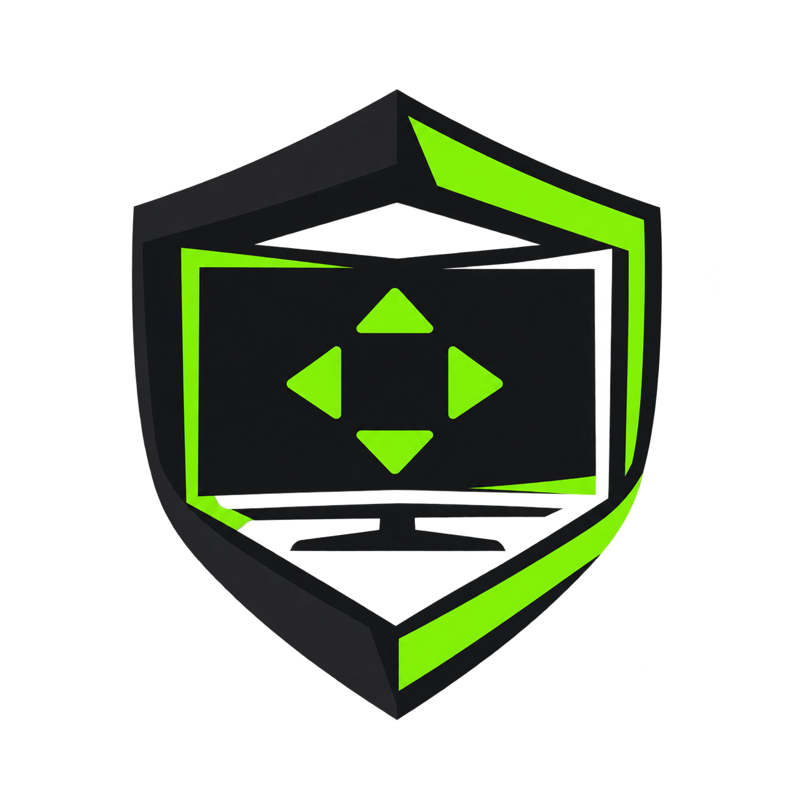
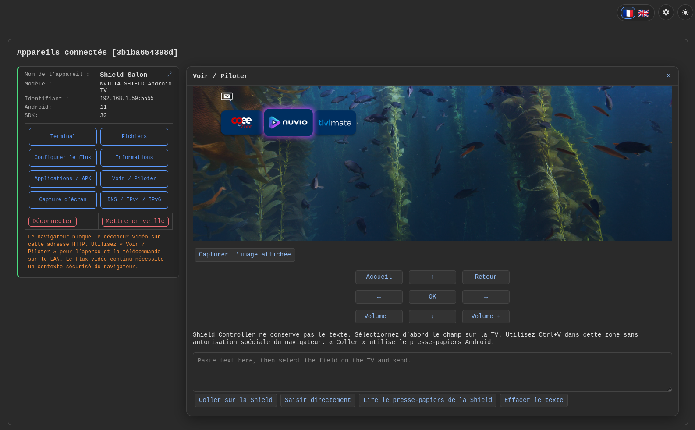
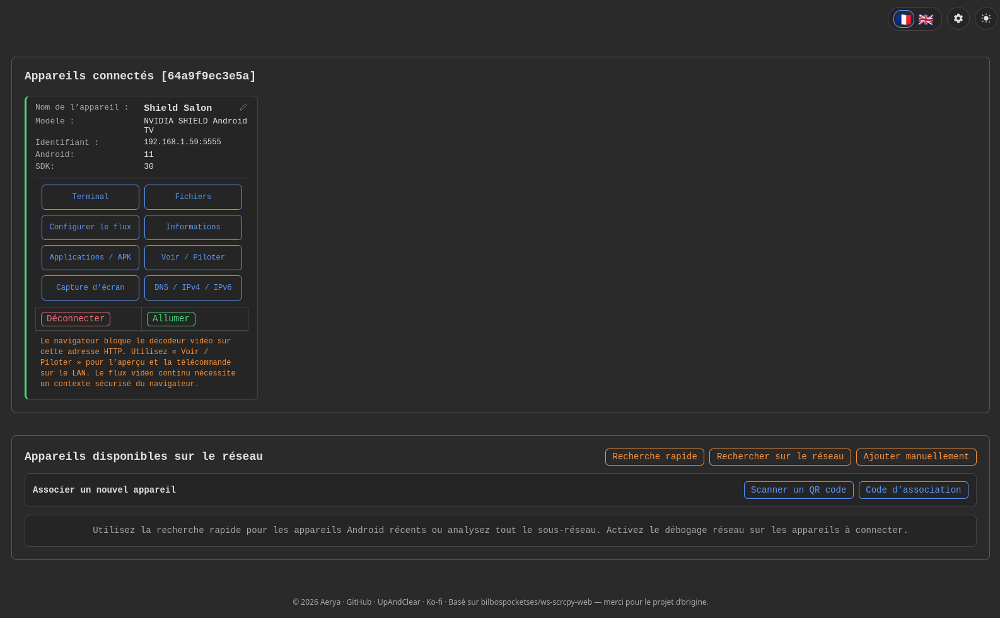
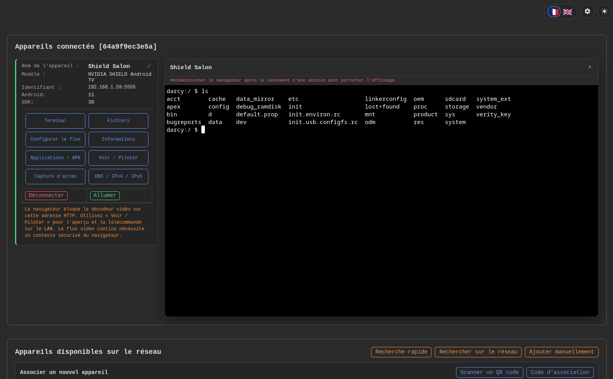
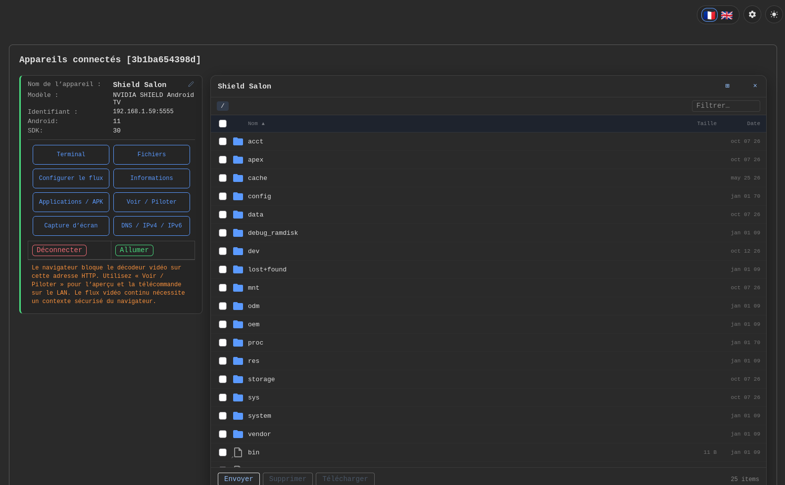
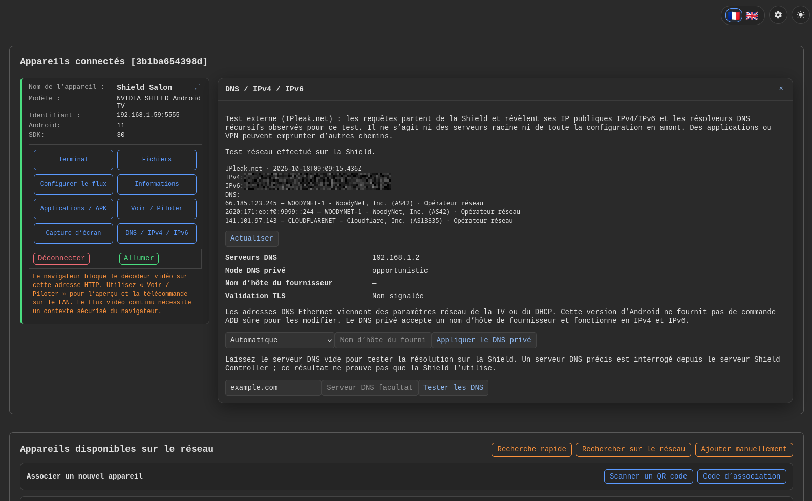
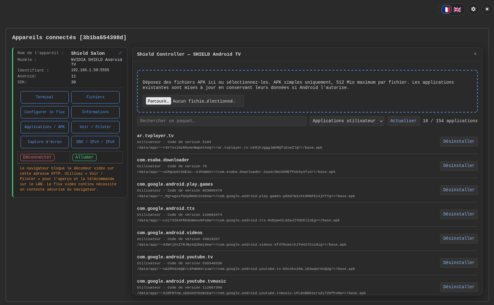
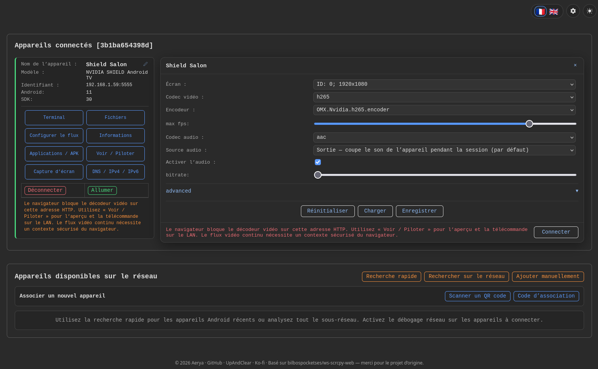
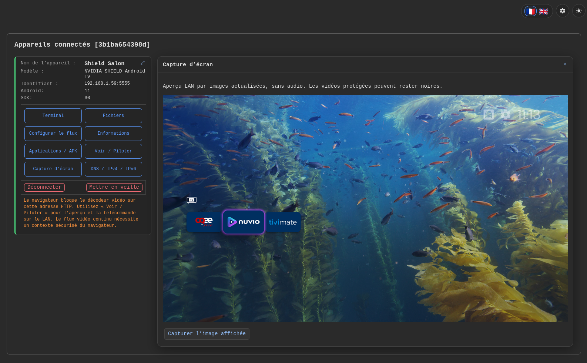

# Shield Controller

<p align="center">
  
</p>

Manage your **NVIDIA Shield / Android TV** from a browser. Self-hosted with Docker.

[Français](README.fr.md) · [Upstream project](https://github.com/bilbospocketses/ws-scrcpy-web)

### TLS security — October 2026

Update image trust stores and TLS components following the eMudhra incident. Checks cover the compromised chains, including both No CT cases, and a valid HTTPS connection. Running images remain unchanged: schedule their replacement after validation.

[Incident details](https://emudhra.we-have-a-problem.com/) · [TLS checks](security/emudhra/README.md)

## Features

- Screen preview and remote control: D-pad, keyboard and text input
- Detailed information: Android, hardware, RAM, storage, network and display
- Drag-and-drop APK installation with upload progress and Android error messages
- Application list with search, user/system/disabled filters and uninstall confirmation
- Remembered devices reconnect automatically at startup
- File browser, transfers and ADB terminal
- French/English interface with tool panels to the right of the device
- PNG screenshots with preview and download, including over LAN HTTP
- Automatic public IP and IPv4/IPv6 DNS detection with provider names, domain tests and Android Private DNS
- CPU, RAM, storage, available temperatures, Android-declared home and foreground application monitoring (optional refresh every 5 seconds).

## Screenshots

| | |
| --- | --- |
| **Remote control and text pasting**<br>[](assets/screenshots/remote-control.png) | **Overview and network discovery**<br>[](assets/screenshots/overview.png) |
| **ADB terminal**<br>[](assets/screenshots/terminal.png) | **File browser**<br>[](assets/screenshots/files.png) |
| **Public IPs and IPv4/IPv6 DNS**<br>[](assets/screenshots/dns.png) | **Applications and APK installation**<br>[](assets/screenshots/applications.png) |
| **Stream settings**<br>[](assets/screenshots/stream-settings.png) | **Screenshot preview**<br>[](assets/screenshots/screenshot.png) |

## Optimization

The panel opens in **Everyday optimization**: telemetry, diagnostics, Plex, user apps, and disabled or protected apps. **Advanced — all applications** exposes the full inventory without removing any option. Dedicated filters also show system components, user apps and protected apps. Apps whose system status is unknown remain visible in the default view.

Known apps have readable names and explanations of their purpose and the consequences of disabling them. This information comes from a curated catalog, not APK label extraction. Unknown packages are explicitly identified as such; their technical identifiers remain visible and searchable. Search matches translated names, package identifiers and explanations within the selected view. Lists use 12 apps per page with a counter, grouped actions, and diagnostics and protection information above the list on desktop and mobile.

The **Optimization** panel lists apps for the active Android user, a process CPU snapshot, memory and storage. A snapshot does not establish that an app slows down boot.

Actions are individual and manual: **Disable**, **Enable**, **Protect**, and **Remove manual protection**. Disabling preserves data but stops the app’s functions and services until enabled again. Filters distinguish NVIDIA/Google telemetry and feedback, NVIDIA diagnostics, the local Plex server (`com.plexapp.mediaserver.smb`) and Plex player (`com.plexapp.android`). Plex database maintenance and Scrob are out of scope.

Before each disable (and in the existing uninstall API), the server checks the resolved home launcher, foreground app and published media sessions (including paused sessions). **Protect** your usual player to keep it protected when closed or when it does not publish a media session. Other apps remain selectable; nothing is disabled automatically. If Android cannot provide reliable protection information, disabling requires a fresh valid diagnostic; enabling remains available.

Persistent history retains the last 200 attempts per device and Android user under the server data directory (`optimization/`), including time, action and result. A pending entry may have been interrupted: refresh the actual device state before retrying. Enable apps again using the disabled apps filter. Detection cannot guarantee protection against a simultaneous app switch on the TV.

## Docker

For **Linux amd64**, use this Compose file in Dockge or with `docker compose up -d`:

```yaml
services:
  shield-controller:
    image: ghcr.io/aerya/shield-controller:latest
    restart: unless-stopped
    ports:
      - "8123:8000"
    environment:
      WS_SCRCPY_ALLOW_REMOTE_ADMIN: "1"
    volumes:
      - ./data:/data
```

Open **http://SERVER_IP:8123** on your LAN. **View / Control** works over HTTP: refreshed screen preview, remote control, pasting and text input. The inherited continuous video stream requires a secure browser context. The variable above grants administrative access to anyone able to reach the service; sign-in is available in Settings → Users.

Build locally: `docker build -t shield-controller:local .`

## Connect your Shield

1. Enable developer options: **Settings → Device Preferences → About → press Build 7 times**.
2. Enable **Network debugging** and note the Shield's IP address.
3. Add `SHIELD_IP:5555` in the WebUI and accept the authorization prompt on the TV.
4. Use **device info** or **applications / APK** on the device card.

Ethernet and Wi-Fi both work. No router port forwarding is needed.

## Remote control and text

Open **View / Control**, select the TV input field with the remote, paste your URL/username in the text box, then click **Paste on Shield**. If the app blocks pasting, try **Type text directly** (300 bytes maximum; non-Latin characters are limited). Shield Controller does not store the text; pasting uses Android’s clipboard. The HTTP preview updates about every 1.5 seconds plus capture time, without audio.

## Notes

Single `.apk` files only, up to **512 MiB each**; split bundles (`.apks`, `.xapk`) are unsupported. Installs update existing apps when Android permits it. Uninstall targets **Android user 0**; removing system apps can break TV functions. App names are shown as package identifiers. Some device details may be unavailable without root. Protected video may appear black in screen mirroring.

## DNS

Each resolver IP includes its known DNS service or network operator (RIPEstat); unavailable identification never hides the result.

Without a custom server, the test runs on the Shield. With an IPv4/IPv6 DNS address, it runs from the Shield Controller server. Private DNS uses a **provider hostname** (DNS-over-TLS). On an unrooted Android 11 Shield, change Ethernet DNS in the TV network settings or DHCP.

Opening the DNS panel automatically detects public IPs and DNS resolvers through [IPleak.net](https://ipleak.net/) from the Shield. It reports observed recursive resolvers, without reading AdGuard Home or listing root servers. Per-app VPN routing may differ.

## Credits & license

Based on **[bilbospocketses/ws-scrcpy-web](https://github.com/bilbospocketses/ws-scrcpy-web)**, with device management additions by Aerya. Screen mirroring uses **[Genymobile/scrcpy](https://github.com/Genymobile/scrcpy)**.

**GPL-3.0-only** — see [LICENSE](LICENSE). Upstream copyright notices are preserved.
